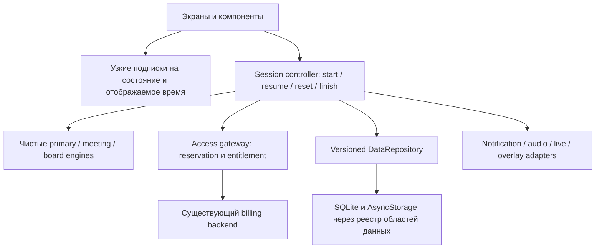

# CorpTimer: архитектура, надёжность и готовность мобильной версии

Дата: **30 октября 2026, America/Los_Angeles**. Проверен исходный код `96a0579581279fc8ab27e394b9fab93eae989f02`; runtime последней Android-сборки — `6b7b5652fb74f947126af70e8f167074b22897f5`, версия **0.4.0 / 6**. Это технический аудит и предложения: код приложения, зависимости, платёжные настройки и опубликованные сборки не изменены.

## Решение, которое я рекомендую

**Сохранить Expo/React Native и существующие чистые движки.** Стек соответствует продукту с большим общим функционалом для Android, iOS и веба. Причин для дорогого переписывания на Kotlin/Swift или Flutter проверка не выявила. Главный долг — неодинаковые правила жизненного цикла, хранения и доступа у основной сессии и дополнительных досок. Следующий этап должен укрепить эти границы и измерить производительность на устройствах.

| Область | Заключение | Уверенность / основание |
|---|---|---|
| Выбор стека | Подходит; сохранять | Высокая: код, локальные проверки, записанное Android CI |
| Функциональность | Рабочая Android-бета с широкой библиотекой; полное равенство с вебом не достигнуто | Высокая: реализованные экраны и явные отсутствующие возможности ниже |
| Корректность | Есть воспроизводимые пограничные ошибки | Высокая: восемь проверок/наблюдений в воспроизводящем скрипте |
| Быстродействие | Есть лишняя работа; степень влияния на телефон пока неизвестна | Высокая для кода, не измерена для FPS/TTI/батареи |
| Защита доступа | Хорошие серверные основы; есть дефект границы новой specialty-сессии | Высокая для проверенных путей; полноценного пентеста не было |
| Android production / Pro | Готовность не подтверждена | Высокая: покупки и Google sign-in выключены, реальные store-сценарии не проверены |
| iOS | Общий код есть; текущая нативная готовность не доказана | Высокая: Hermes-export не заменяет запуск и проверку на iPhone |

Не присваиваю оценку «8/10 по оптимизации»: нет измерений, из которых можно честно получить такое число. Критический дефект уровня P0 в проверенном объёме не установлен; это не гарантия отсутствия остальных ошибок.

## Метод и применённые skills

- [CTO Advisor](https://github.com/alirezarezvani/claude-skills/tree/82d55e14b561b846abc22dc84bc532d2a2877daa/c-level-advisor/skills/cto-advisor): приоритет долга по последствию для продукта, варианты архитектурного решения, цена сложности и условия приёмки.
- [Callstack React Native Best Practices](https://github.com/callstackincubator/agent-skills/tree/59e9d17446a248b21d86f078fcd0bd2d36db1ca4/skills/react-native-best-practices): измерять, менять установленный bottleneck, повторять измерение.
- Установленные Vercel React Native Skills, Expo Design System и Expo Animation: состояние, списки, границы UI/JS-потоков, единая тема, жесты и reduced motion.

Две найденные библиотеки скачаны в игнорируемый `.local/audit-skills/` с закреплёнными ревизиями для этого аудита; глобальная установка не выполнялась. Это не специализированная сертификация CTO и не независимый пентест. Проверка информационная, без решений о расходах или публикации. Междисциплинарные юридические и финансовые заключения не делались. `company-context.md` в рабочей копии не найден.

Заново выполнены: **40/40 мобильных тестов, 59/59 веб-тестов, 9/9 серверных тестов, TypeScript, Expo lint и веб-проверка JavaScript/JSON**. Серверные Google-ответы в тестах замоканы. Дополнительный [скрипт воспроизведения](reproduce.mjs) исполняет реальные чистые функции и извлечённые клиентские обработчики с локальными заглушками. Он не обращается к Firebase, Google, Web3Forms или данным пользователя. [Результаты](reproduction-results.json), [сводка проверок и SHA-256 исходников](evidence.json).

Существующее Android CI содержит реальные phone/tablet сценарии и видео плавающего таймера. В этом аудите они использованы как **ранее записанные свидетельства**, повторного эмуляторного прогона не было: [основной прогон](https://github.com/cytramonp/relay-timer/actions/runs/41053160974), [демонстрация foreground service](https://github.com/cytramonp/relay-timer/actions/runs/41056996208). Подробные границы — в [VALIDATION.md](../../VALIDATION.md).

## Что уже устроено хорошо

1. **Чистая предметная логика.** Расчёты вынесены из UI в `core/clock.ts`, `core/meeting.ts`, `core/board-engine.js`; есть проверки пауз, переходов, восстановления и согласованности с вебом. Движок specialty сейчас побайтно совпадает с веб-копией, что контролируется тестом. Источники времени передаются аргументом, поэтому ошибки времени можно воспроизводить без телефона.
2. **Отсчёт от временной опоры.** Время не уменьшается на единицу в каждом `setInterval`: после пропущенных JS-тиков состояние догоняется расчётом. Это правильно для приостановки JavaScript; скачки системного времени требуют отдельного решения ниже.
3. **Защита текущей работы.** Основной новый запуск ждёт серверную резервацию до замены старого таймера. Есть блокировка повторного нажатия, устойчивый pending-ID и атомарная серверная квота. При нечитаемом сохранении исходные данные не затираются молча.
4. **Нативные жесты и визуальный фундамент.** Вращение указателя и перетаскивание строки идут через Gesture Handler/Reanimated. Крутилка и граница сегмента подтверждают изменение на отпускании пальца, а не записывают всю библиотеку на каждом кадре. У дыхательной анимации есть системный reduced motion. Сохранены тема сайта, светлый/тёмный режимы, табличные цифры, accessibility-действия и альтернативный ввод.
5. **Сервер — источник оплаченного доступа.** Клиент не выдаёт себе Pro по ответу BillingClient: подготовлен серверный запрос к Google, проверка состояния/продукта и acknowledge. Ответ доступа проверяется на смену Firebase UID. Квота использует compare-and-swap и идемпотентные ID. Это соответствует направлению [официальных рекомендаций Google](https://developer.android.com/google/play/billing/security), но реальные покупки ещё не проверены.
6. **Сдержанные разрешения и разделение данных.** Нет микрофона и широких разрешений на медиа; приватные заметки исключены из live-проекции. В Firestore запрещено перечисление публичных комнат, управление отделено capability-ссылкой, доступ ограничен сроком. Ключ подписи не включён в исходники/релиз.

## Приоритетные находки

P1 — исправить до публичного продвижения соответствующей возможности. P2 — исправить в следующем цикле укрепления. Это продуктовые приоритеты, а не CVSS. Сложность S/M/L — относительная оценка объёма, не обещание сроков.

### F1 · P1 · Сохранённая specialty-доска не имеет надёжной границы новой сессии · M

**Подтверждено на коде и извлечённом обработчике.** В [specialty route, строки 143, 260–313](https://github.com/cytramonp/relay-timer/blob/96a0579581279fc8ab27e394b9fab93eae989f02/mobile/src/app/specialty/%5Bslug%5D.tsx#L260) `session.current` восстанавливается с доской. Сервер вызывается только при пустом session. Индивидуальный Reset очищает часы, но не session; только Reset board, загрузка/импорт setup обнуляют его. Три старта с двумя индивидуальными Reset дают **одну** резервацию.

**Последствие:** можно снова использовать одну доску, включая после смены дня/истечения доступа, без новой проверки старта. Это отличается от основных таймеров и ослабляет смысл «две сессии в день». Повторная пауза/продолжение одной незавершённой сессии, напротив, не должна расходовать квоту повторно.

**Предложение:** явно определить новую сессию доски, её завершение, перезапуск завершённой/сброшенной доски и повтор после истечения grant. Общий контроллер выдаёт новую резервацию для нового выполнения; resume сохраняет старую. Не пытаться решить это исключительно сбросом ID на любом нажатии Reset: на многочасовой доске это может неожиданно изменить тарифную семантику.

**Приёмка:** новая работа после полного завершения/сброса и смены аккаунта проверяет доступ; resume и сетевой retry не списывают квоту дважды. Тесты пересечения дня и истечения trial обязательны. Граница оплачиваемой сессии — предлагаемое продуктовое правило, а не уже согласованное требование.

### F2 · P1 · «Все локальные данные» и device export охватывают только часть хранилищ · M

**Подтверждено чтением кода.** [Settings:125–139](https://github.com/cytramonp/relay-timer/blob/96a0579581279fc8ab27e394b9fab93eae989f02/mobile/src/screens/settings.tsx#L125) экспортирует `rawStore()`, а диалог говорит «Delete all local data?». [resetDevice:471](https://github.com/cytramonp/relay-timer/blob/96a0579581279fc8ab27e394b9fab93eae989f02/mobile/src/state/app-store.tsx#L471) вызывает `commit(emptyStore())`. Это один SQLite-backed ключ. Specialty-доски, отдельные setup, избранное, черновик feedback и live-host лежат отдельно в AsyncStorage.

**Последствие:** пользователь может ожидать удаления активной доски или полного переноса данных, а она сохранится либо не попадёт в экспорт. Экспорт SQLite также не является готовым импортируемым архивом всего приложения: текущий импорт библиотек восстанавливает планы.

**Предложение:** реестр принадлежащих приложению ключей и versioned `DataRepository` с явными операциями «экспорт планов», «резервная копия пользовательских данных», «очистить библиотеку», «удалить локальные данные». Не использовать бездумный `AsyncStorage.clear()`: там есть auth-персистентность. Секреты, receipt-токены и активные capability-ссылки не включать в переносимый backup; перед очисткой live-host согласованно отозвать публичную комнату или честно сообщить о неудаче.

**Приёмка:** заселить каждое хранилище синтетическими данными, проверить reset/relaunch и restore/relaunch. Подтверждение перечисляет реальный объём действия. Удаление локальных данных не выдаётся за удаление серверного аккаунта.

### F3 · P2 · Reset/Start отдельного кухонного таймера сохраняет старый отложенный запуск · S

**Воспроизведено.** [board-engine.js:47–62](https://github.com/cytramonp/relay-timer/blob/96a0579581279fc8ab27e394b9fab93eae989f02/mobile/src/core/board-engine.js#L47) не очищает `scheduledAt`. [Интервал specialty:209–216](https://github.com/cytramonp/relay-timer/blob/96a0579581279fc8ab27e394b9fab93eae989f02/mobile/src/app/specialty/%5Bslug%5D.tsx#L209) запускает часы, когда наступает эта дата. Общие Start all/Pause all очищают поле, индивидуальные действия — нет.

**Сценарий:** запланировать приготовление → Reset конкретных часов → дождаться старого времени. Часы запускаются сами. Если до этого вручную нажать Start, старое расписание позже переустанавливает anchor и отсчёт начинает вести себя неверно.

**Предложение/приёмка:** явные переходы Scheduled → Cancelled/Running. Reset и ручной Start отменяют старое расписание; поведение индивидуальной Pause тоже определить. Проверить оба сценария на чистом движке и один — в Android UI. Исправление синхронизировать с веб-движком, сохранив проверку равенства.

### F4 · P1 для обещания точных фоновых сигналов · Доставка алармов имеет неподтверждённые условия · M/L

**Пробел в коде подтверждён; фактическая задержка на устройствах не измерена.** [notifications.ts:18–31](https://github.com/cytramonp/relay-timer/blob/96a0579581279fc8ab27e394b9fab93eae989f02/mobile/src/services/notifications.ts#L18) запрашивает разрешение показывать уведомления, но не проверяет/запрашивает отдельный доступ exact alarms. Настройки после этого сообщают, что фоновые сигналы включены. Манифест содержит `SCHEDULE_EXACT_ALARM`, однако декларация не равна выданному доступу.

По [документации установленного Expo SDK 58](https://docs.expo.dev/versions/v58.0.0/sdk/notifications/), на новых Android 14+ установках этот доступ по умолчанию запрещён; есть `getExactAlarmPermissionsAsync` и `requestExactAlarmPermissionsAsync`. Без него уведомление может прийти приблизительно. Даже при наличии доступа текущий default `bestEffort` не доказывает отсутствие OEM/Doze-задержек. Это не утверждение, что уведомления всегда падают с исключением или совсем не работают.

Кроме того, [alarmPlan:326–360](https://github.com/cytramonp/relay-timer/blob/96a0579581279fc8ab27e394b9fab93eae989f02/mobile/src/core/clock.ts#L326) ограничивает план 48 событиями. Для длинных серий это конечный горизонт, а не обещание всех сигналов без дальнейшего исполнения JS. Specialty-доски вообще не подключены к этому OS-планировщику; экран честно просит держать приложение открытым.

**Предложение:** единая модель готовности сигналов: notification permission, exact access, выбранный delivery, горизонт расписания и возможности данного таймера. Запрашивать специальный доступ по осмысленному действию пользователя; не показывать успех до проверки готовности. Подключение specialty — отдельная работа, а не один общий флаг. Выбор `alarmClock` требует обоснования UX/категории; не менять режим всем уведомлениям автоматически.

**Приёмка:** свежая установка с запрещённым/разрешённым exact access, его отзыв, заблокированный экран, Doze, длинная программа за пределами 48 событий, восстановление и перезагрузка — с измеренными временем ожидания/доставки. Принудительную остановку ОС описывать честно, без обещания обойти её.

### F5 · P2 · Частые UI-обновления и синхронная запись большого store · M

**Лишняя работа видна статически; лаги и расход энергии не измерены.** [AppProvider:137–192](https://github.com/cytramonp/relay-timer/blob/96a0579581279fc8ab27e394b9fab93eae989f02/mobile/src/state/app-store.tsx#L137) обновляет общий Context каждые 200 мс работающего таймера. Новый `value` заставляет подписчиков `useApp()` получать изменение, даже когда им нужны только настройки или библиотека. Specialty вызывает `setNow` каждые 200 мс даже у полностью приостановленной открытой доски. `settle()` дополнительно копирует stages/laps каждого элемента.

`commit()` синхронно сериализует и пишет **весь** SQLite-backed store; заметки/редактирование вызывают его часто. В store также могут лежать история и большой data-URI логотипа. Важное уточнение: обычный 200-мс тик сам по себе **не** пишет весь store в SQLite. Это не обнаруженная запись пять раз в секунду.

**Предложение:** отделить локальную подписку на отображаемое время от сохраняемых доменных изменений; selectors/`useSyncExternalStore` или узкие Context без обязательной новой state-библиотеки. При отсутствии движения и будущего запуска — выключать ticker; для секундных часов обновлять текст на границе видимой секунды, для tenths/анимации оставлять нужную частоту. Убрать ненужные копии, а не нарушать иммутабельность. Критические start/pause/transition сохранять немедленно; ввод заметок пакетировать с flush при уходе с экрана/в фон.

Предел specialty — 12 часов × 500 lap-строк в `ScrollView`; History тоже не виртуализирован. Это нагрузочный сценарий, а не доказанный тормоз. Применять виртуализацию там, где профиль подтвердит её пользу; каталог из 36 таймеров сам по себе не требует FlashList.

**Приёмка:** профиль до/после на одном release/profileable build и одинаковом телефоне: количество React commits, время JS, frame timing, память; отдельный сценарий большой библиотеки и ввода заметок. Не принимать «добавили memo» за измеренный выигрыш.

### F6 · P2 · Перевод системных часов меняет длительность обычного таймера · M

**Воспроизведено на функции времени:** stopwatch показывает `0:10`, после сдвига переданного wall-clock на час — `60:10`. У primary и native overlay тоже используются epoch-опоры; пользовательская смена timezone сама по себе epoch не меняет и к этому дефекту не относится.

**Предложение:** абстракция Clock. Для длительностей — монотонный источник, продолжающийся во сне; для календарных событий New Year/Serving — wall-clock. Сохранять checkpoint и данные для восстановления после убийства процесса/перезагрузки, не переносить старый monotonic anchor между boot. Один голый `performance.now()` без проверенных sleep/restart-свойств не решает всю задачу. Android рекомендует [SystemClock.elapsedRealtime для интервалов](https://developer.android.com/reference/android/os/SystemClock).

**Приёмка:** скачки wall-clock в обе стороны во время run/pause, сон, перезапуск процесса, reboot и календарные события сохраняют выбранную семантику. Не ломать уже работающий расчёт догоняющих переходов.

### F7 · P2 · Очередь уведомлений исполняет устаревшие состояния · S/M

**Воспроизведено с задержанным OS-mock.** [syncNotifications:32–89](https://github.com/cytramonp/relay-timer/blob/96a0579581279fc8ab27e394b9fab93eae989f02/mobile/src/services/notifications.ts#L32) последовательно исполняет все поступившие snapshots. Если enqueue Start A → изменить на B → Pause до завершения первого OS-вызова, очередь всё равно сначала планирует A и B, затем отменяет. Фактическая длительность опасного окна и реальная ложная доставка не измерены.

**Предложение:** coalescing до последнего желаемого состояния и generation-ID с проверкой после await; небольшой согласователь OS-состояния вместо накопления полных исторических перепланирований. Последний Pause/Reset имеет приоритет. После завершения согласования не должны оставаться уведомления старой генерации.

### F8 · P2 · Remote Next подтверждается до успешного асинхронного старта · S

**Воспроизведено на реальном callback с mock start, завершившимся `false`.** [live-store.tsx:101–119](https://github.com/cytramonp/relay-timer/blob/96a0579581279fc8ab27e394b9fab93eae989f02/mobile/src/state/live-store.tsx#L101) вызывает `app.start("meeting")`, сразу ставит `lastCommand` и удаляет команду, не дожидаясь результата доступа/сети.

**Последствие:** контроллер видит подтверждение команды, а встреча не начинается. Особенно заметно после появления обязательной серверной резервации.

**Предложение/приёмка:** await boolean-результата, один command executor, явный результат rejected/expired/accepted и подтверждение только принятого действия. Идемпотентность не должна превращаться в бесконечные повторы; проверить pending → false, pending → true, повтор команды, смену комнаты/аккаунта.

### F9 · P2 · Допустимая библиотека экспортируется в неимпортируемый файл · S/M

**Воспроизведено:** 200 допустимых программ по 200 допустимых agenda-элементов дают **10 341 960 байт** через [writeBackup](https://github.com/cytramonp/relay-timer/blob/96a0579581279fc8ab27e394b9fab93eae989f02/mobile/src/core/backup.ts#L217), а `readBackup` и file picker ограничены 4 MB. Экспорт завершается без предупреждения о невозможности обратного импорта.

**Предложение:** согласованные лимиты и формат переноса: проверка размера до сохранения, экспорт выбранной части либо manifest/chunks/архив с ограниченным распакованным размером. Не просто снимать все ограничения JSON: это создаст риск памяти на слабом устройстве. **Приёмка:** каждый успешно выданный приложением поддерживаемый backup восстанавливается в пределах заявленных лимитов либо UI до экспорта явно предлагает разделение.

### F10 · P2, низкий охват · После 500 кругов неверны первый оставшийся split и номер · S

**Воспроизведено:** записать 501 круг по секунде. UI сохраняет последние 500 timestamps; [boardCsv:175–184](https://github.com/cytramonp/relay-timer/blob/96a0579581279fc8ab27e394b9fab93eae989f02/mobile/src/core/board.ts#L175) считает первый из них от нуля. Вместо реального круга №2 со split 1 s экспортирует №1 со split 2 s. Аналогичную модель primary laps проверить при исправлении; воспроизведение здесь выполнено для specialty.

**Предложение/приёмка:** хранить `lapOffset` и предшествующий elapsed либо явные lap number/split; указать ограничение истории. Проверить 500/501/502 кругов и сохранение/CSV после relaunch.

## Архитектура: предлагаемое постепенное изменение

Это направление, **не уже внесённая архитектура**. Сначала общий контракт `TimerSession`/Clock/переходов и тесты, затем постепенное подключение экранов. Не нужно срочно объединять все алгоритмы в один огромный движок: у встречи, шахмат и независимых часов разная семантика. Полезно унифицировать жизненный цикл и эффекты, сохранив специализированную математику.

| Вариант | Выгода | Цена/риск | Решение |
|---|---|---|---|
| Только точечные исправления | Быстро закрывает ошибки | Новые таймеры снова расходятся в правилах | Нужен первым этапом, недостаточен надолго |
| Общие контракты и адаптеры в нынешнем Expo | Повторное использование, ясные границы, контролируемые миграции | Потребует тестов store и эффектов | Рекомендую постепенно |
| Полная нативная перепись | Максимальный контроль платформы | Две реализации, перенос UI и логики, новые регрессии | Нет измеренного обоснования |
| Новый state framework/БД целиком | Может упростить отдельные подписки/записи | Миграция без доказанного bottleneck | Рассматривать после профиля |

`specialty/[slug].tsx` — 959 строк, в одном месте UI, доступ, persistence, импорт/экспорт, редактирование и сигналы. Выделить `BoardSessionController`, `useBoardPersistence`, `ClockCard`, редактор и file adapters. Цель — возможность проверить переходы и эффекты, а не формальный лимит строк. Дублированный веб/мобильный board-engine лучше генерировать из одного источника или вынести в общий пакет, сохранив существующие контрактные тесты.

Native overlay — проекция с экстраполяцией времени, команды исполняет JS; это **не автономный движок встречи**, устойчивый к остановке JS/процесса. Его ticker работает каждые 250 мс даже в paused/done. В store-описании сказано «stops ... when the task ends», а код сам не завершает service на done. Уточнить требуемое поведение, синхронизировать декларацию с ним и остановить ненужные обновления. Возможность Undo после конца может быть сознательной: это не повод закрывать окно без решения о UX.

## Размер, зависимости и эксплуатация

Файлы заново прочитаны, их SHA-256 совпали с журналом релиза. [Полный разбор ZIP](artifact-composition.json).

| Измерение | Факт |
|---|---:|
| Universal APK | 75 561 216 B / 72,06 MiB |
| Native ARM64 внутри APK | 26 682 728 B |
| Native x86_64 внутри APK | 28 367 352 B |
| Hermes `index.android.bundle` | 6 354 660 B |
| Два DEX, сжатые в APK | 6 148 906 B |
| AAB для Google Play | 56 740 848 B / 54,11 MiB |

Около 55,05 MB APK занимают native-библиотеки **двух ABI**. Это не размер загрузки одному пользователю через Play. AAB включает mapping/debug-symbol metadata; его размер тоже нельзя выдавать за размер установленного приложения. Удалять symbols ради красивого числа не предлагаю: они нужны для диагностики. Сначала оценить device-specific delivery через bundletool/Play и проанализировать JS bundle; только затем убирать реально неиспользуемые модули/шрифты/ресурсы. Произвольное сжатие `.so` не должно нарушить 16 KB ZIP alignment.

Заново проверенный `npx expo install --check` сообщает **15 несовпадений patch-версий**, включая Expo 58.0.19 → ~58.0.21 и RN 0.88.0 → 0.88.1. Это работа по сопровождению, а не доказательство поломки приложения. `npm audit --json` сейчас показывает **28 affected-package entries: 2 high, 24 moderate, 2 low, 0 critical**. Они распространяют **четыре базовых advisory**, а не означают 28 независимых ошибок в пользовательском коде. High — Zod и его Expo CLI-зависимость; `npm explain zod` ведёт к CLI и ESLint React Hooks. Достижимость этих проблем в shipped Hermes-путях не установлена. [Точная сводка и ссылки advisory](dependency-audit.json).

Рекомендация: отдельное совместимое patch-обновление и dependency triage с чистым `npm ci`, тестами, Hermes-export и Android regression. Не запускать `npm audit fix --force`: предлагаемые автоматически downgrade/major-замены Expo несовместимы с задачей. Инструменты разработки тоже требуют защиты CI от недоверенного ввода; это не основание объявлять телефон взломанным.

Каждый новый primary start сейчас требует сети, включая Pro; текущий running timer может продолжать работу при сбое. Это осознанная архитектурная зависимость доступности продукта от Firebase/Worker, не ошибка самого HTTP-кода. Нужен явный UX и решение об ограниченном сервером offline-grant для Pro, если офлайн важен. Нельзя просто доверять локальному флагу Pro. После включения Play сервер на проверках доступа заново обращается к Publisher API; измерить latency и частоту запросов, затем при необходимости добавить короткий cache/RTDN-согласование с правилами отмены, истечения и возврата. Сейчас этот серверный Play-путь не активирован в продакшене.

В CI уже есть сборка/тесты, подпись/проверка артефакта и полезный native driver. Дальше нужны профиль сборки для измерений, небольшой набор критических OS/store сценариев, приватные структурированные ошибки с release/source ID и учёт crash/ANR без заметок, имён участников, токенов и содержимого feedback. Новую аналитическую/Sentry-службу без отдельной необходимости подключать не требуется. Перед production закрепить используемые Actions по SHA, сохранить проверяемое происхождение build tools и проверить восстановление из резервной копии upload key, не публикуя его.

## Матрица требований и готовности

| Требование | Что есть | Что ещё не доказано / отсутствует |
|---|---|---|
| Welcome + пять участников, час | По умолчанию 5 min + 5 × 11 min; проверено тестом | Не менять на прежнее «2 минуты» без нового требования |
| Meeting, ячейки времени, следующий участник, drag | Реализовано; native-сценарии зафиксированы | Нагрузочные 200 строк, TalkBack и текущая аппаратная проверка |
| Крутилка + числовой ввод + звук | Есть; UI-thread pointer и detent feedback; native decimal/120 min проверки | Системный большой текст, прерывания аудио и хаптика на разных устройствах |
| Палитра веба, светлая/тёмная тема | Есть общие tokens, текущие native screenshots просмотрены | Скриншоты не доказывают accessibility/качество движения; нужна аппаратная проверка |
| Весь каталог веба | 9 основных + 27 specialty + custom routine | Общая история/backup/reset/access/background не унифицированы |
| Free/Pro | Квота/план UI и серверные основы есть | F1; Google login/покупки выключены; shared entitlement и реальные lifecycle не проверены |
| Работа без открытого приложения | Primary OS schedule + Android floating service | F4, F7; specialty OS alarms отсутствуют, autonomous overlay не реализован |
| Support без адреса получателя в клиенте | Web3Forms HTTPS-форма, локальный черновик, timeout; публичный alias | Новое сообщение и доставку письма этот аудит не проверял |
| Синхронизация приватной библиотеки веб ↔ mobile | Импорт планов / отдельный live sharing | Нативной private-library sync нет |
| Android Google Play | Подписанный AAB, target36, recorded 16 KB проверки, listing kit | Аккаунт/верификация, реальные покупки, итоговые notices/Data safety/декларации, требуемые тестовые треки |
| iOS / App Store | Общий Expo-код и recorded native export | Актуальный native build/run, alarm/gesture/device QA, подпись, TestFlight, покупки/публикация |

Текущий target API36 соответствует [опубликованным требованиям Google Play на дату аудита](https://support.google.com/googleplay/android-developer/answer/11926878). Записанные проверки 60 ELF и ZIP-offset/BundleConfig — полезное свидетельство подготовки к [16 KB совместимости](https://developer.android.com/guide/practices/page-sizes); выравнивание файлов не заменяет runtime-тест на устройстве с 16 KB страницами. Подписанный AAB и зелёные тесты не являются одобрением Google Play.

## План улучшений и критерии окончания

1. **Корректность и доверие к данным.** F1/F2/F3/F8/F9, затем F10. Зафиксировать определения session/backup/reset, добавить именно пропущенные регрессии и проверить свежую/обновлённую установку. Выход: воспроизводящие дефекты закрыты; UI и документация описывают реальное поведение.
2. **Гарантии времени и фоновых эффектов.** F4/F6/F7 и договорённость о завершении overlay. Матрица fresh permissions / sleep / reboot / process-kill, обычные и длинные сессии. Выход: понятные пользователю уровни готовности, измеренная доставка в заявленных режимах; незаявленные ограничения не скрываются.
3. **Измерение и адресная оптимизация.** Сначала исходная запись на Android среднего/слабого класса и актуальном iPhone; затем F5, дробление board route и повтор профиля. Для Android подходит [Macrobenchmark startup/UI + trace](https://developer.android.com/topic/performance/benchmarking/macrobenchmark-overview); React/Hermes profile использовать отдельно для причин JS-работы. Это потребует profileable/release-конфигурации: её в данном аудите не добавляли.
4. **Store-активация.** Совместимые patch-зависимости, реальный Play internal-track purchase/restore/pending/cancel/expiry/refund/account switch, работа поддержки и удаления аккаунта для включённого sign-in. Финализировать notices и декларации по действительному поведению; выполнить обязательные для аккаунта тестовые треки. Отдельный аналогичный этап iOS.

Предлагаемые performance-ворота, которые ещё надо согласовать с выбранными устройствами: cold/warm startup и первый доступный экран измерены серией запусков; frame timing drag/scroll фиксируется trace, без устойчивых JS-провалов; paused screen не содержит бессмысленного clock ticker; start/pause/handoff не теряются при сетевом ожидании; память не растёт после 20 циклов открытия/закрытия досок; десятиминутные foreground/paused/floating сценарии имеют сравнимые замеры CPU/энергии. Результаты хранить с моделью устройства, OS, build hash и сценариями. Не переносить FPS эмулятора или Node benchmark на реальные телефоны.

Стоимость и сроки аппаратной/store-фазы пока не оценены: неизвестны доступные устройства, аккаунты и тестировщики. Работу стоит вести небольшими проверяемыми изменениями поверх текущего стека. Эти предложения не разрешают автоматически менять тарифы, включать оплату, отправлять обращения или публиковать приложение.
