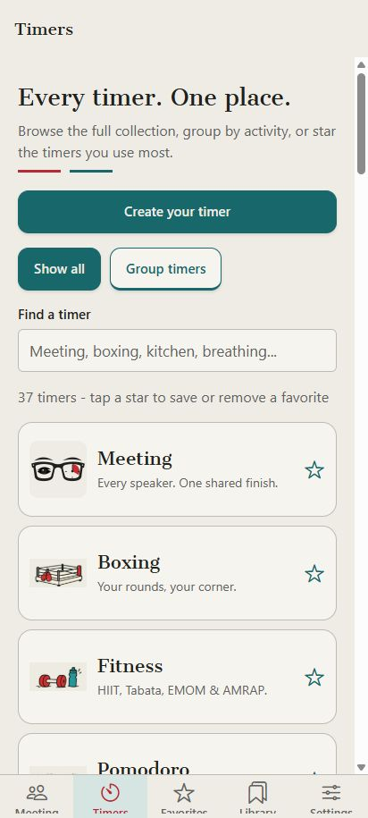
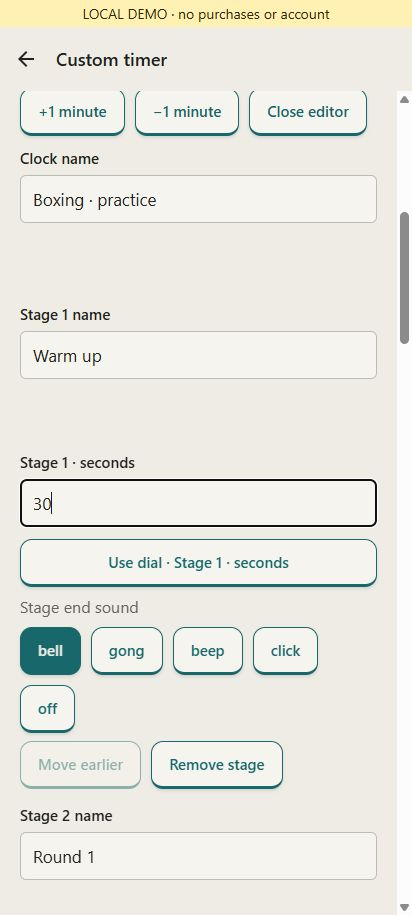
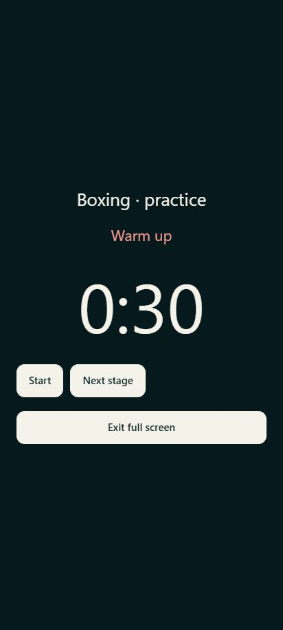

# Создать свой таймер в CorpTimer

Инструкция к мобильной версии 0.5.0. Иллюстрации сняты с реального интерфейса Expo в Chrome, в локальном деморежиме; это не доказательство покупки Pro или тестирования на физическом телефоне.

## Начало

Откройте **Timers → Create your timer**. Все готовые таймеры остаются ниже, в полном списке; **Group timers** распределяет их по занятиям. Звёздочка добавляет таймер в **Favorites**.

## Пример: Boxing

Откройте примеры рецептов и выберите **Boxing · 3 rounds**. Приложение создаст отдельный сохранённый таймер: 1 минута подготовки, три раунда по 3 минуты и два отдыха по 1 минуте. Последнего отдыха нет. Время подготовки и раундов можно менять; новый рецепт не заменяет ранее сохранённый.

Нажмите **Customize timer** или **Edit clock**. В **Clock name** задайте название. У каждого этапа есть **Stage name** и длительность в секундах. Например, 180 секунд — три минуты. Можно ввести число или открыть **Use dial** и повернуть круговой регулятор. **Add stage** добавляет этап; **Move earlier** меняет порядок; **Remove stage** удаляет ненужный этап. **Apply clock changes** применяет правки. Изменение длительности или состава этапов сбрасывает текущий прогресс; переименование сохраняет его.

## Пример: Egg

Выберите **Egg · 7-minute demo**: приготовление 420 секунд, затем охлаждение 120 секунд. Это редактируемый пример: задайте своё время. Можно удалить этап охлаждения, добавить напоминание или поменять название. Сохраните новый таймер, чтобы затем открыть его из Library.

## Сигналы, цвет и логотип

У этапа выберите **bell**, **gong**, **beep**, **click** или **off**. В блоке оформления загрузите свой звук через **Upload sound**, проверьте **Preview my sound** и выберите **My sound** у нужного этапа. Поддерживаются MP3, WAV, M4A, AAC и OGG до 2 MB; поддержка конкретного кодека зависит от устройства. Приложение копирует небольшой файл в настройку, поэтому экспорт переносит его вместе с таймером.

Звуки этапов и свой файл работают при открытом приложении. Для фоновых уведомлений включите **Settings → Background alerts**; они используют стандартный системный сигнал. Предпросмотр кнопкой не заменяет проверку громкости на телефоне.

Выберите цвет акцента или введите `#RRGGBB`. Цифры сохраняют читаемый контраст. **Upload company logo** принимает PNG, JPEG или WebP до 2 MB. В **Settings → Colors & company logo** можно выбрать общую палитру и логотип для всех таймеров. Редактирование и фирменное оформление доступны в Trial/Pro.

## Сохранение и перенос

- **Save setup** обновляет исходный план этого таймера.
- **Save as new timer** создаёт независимую копию в **Library**.
- **Load setup** восстанавливает сохранённый план вместо текущего состояния.
- **Export setup / Import setup** переносят один таймер в JSON.
- **Settings → Export device backup** сохраняет программы, историю, избранное, настройки и собственные таймеры. Ключи входа и платёжные разрешения в файл не включаются.

Новая копия проверяется на совместимость с лимитом резервной копии. Если места для экспорта не хватает, приложение объяснит это до создания копии. Удаление сохранённого плана не удаляет текущие часы: это явно указано в подтверждении.

## Полный экран и проверка

На тёмной панели нажмите **Full screen**. Проверьте название, длительность и следующий этап. Выполните короткий пробный запуск, паузу и переход к следующему этапу. Выход не создаёт второй таймер и не останавливает исходный.

## Десять готовых примеров

Boxing, Egg, Focus 25+5, Tea, Stretch, Presentation, HIIT, Breathing, Workshop и Cleanup доступны в галерее рецептов. Их импортируемые файлы находятся в `mobile/examples/custom-timers/`. Сценарий видеосерии — [VIDEO-PLAN.ru.md](VIDEO-PLAN.ru.md).

## Подписка

В **Settings → Your plan** отображается Trial, Free или Pro. Покупка в Google Play использует аккаунт магазина и не требует отдельного входа Google в CorpTimer. Вход в веб-аккаунт — отдельная необязательная возможность. Покупки доступны только в сборке с подключённой и проверенной конфигурацией магазина; в тестовой сборке недоступная покупка явно обозначена.
